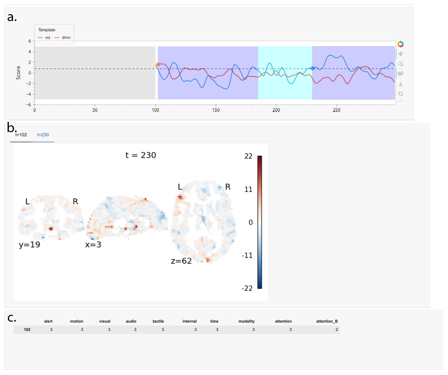

# Visualization

This package builds the live operator interface during ESAM runs.

*Screenshot of the operator's view, which updates in real time as new data
arrives. The interface shows (a) each brain volume's match score against each
template, (b) the participant's brain activity at each hit, and (c) the
participant's behavioral survey responses at each hit.*
